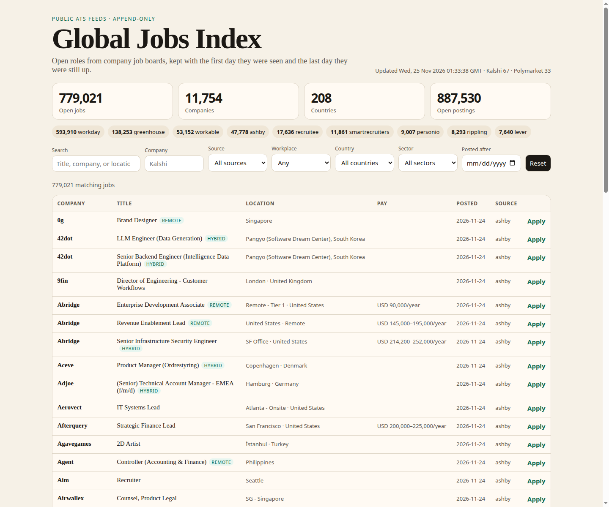
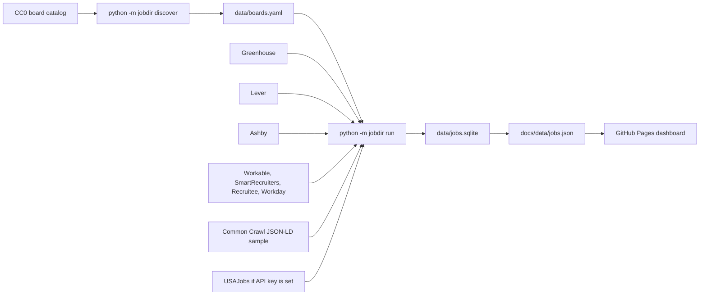

# Global Jobs Index

A public directory of open jobs, built to grow toward every posting on the internet without pretending a single scrape can get there. This version pulls real listings from company applicant-tracking systems, keeps every observation, and publishes a static dashboard.

The index is append-only. A job keeps `first_seen` from the first time a source returned it and `last_seen` from the latest sighting. When a board is fully refreshed and a listing is gone, that listing is marked closed. The old observations stay in SQLite.

## Coverage in this build

Pulled 2026-11-24 from the seed registry. The dashboard headline matches `docs/data/stats.json`.

| | |
|---|---|
| Open jobs (deduped) | 53,672 |
| Open postings | 56,210 |
| Companies | 434 |
| Countries | 94 |
| Jobs with a pay range | 5,403 |
| Remote jobs | 6,170 |
| Seeded boards | 456, of which 450 returned a live board. Six stale Lever tokens 404'd and were not closed-out because the read failed. |
| Kalshi | 68 open jobs (Greenhouse `kalshi` and Ashby `kalshi`) |
| Polymarket | 33 open jobs (Ashby `polymarket`), including structured USD ranges |

Postings by source:

| Source | Open postings |
|---|---|
| Greenhouse | 20,922 |
| SmartRecruiters | 11,883 |
| Lever | 7,641 |
| Workday | 6,512 |
| Ashby | 4,336 |
| Workable | 2,715 |
| Recruitee | 2,195 |
| Common Crawl | 6 |

The Common Crawl sample read the November 2026 crawl `CC-MAIN-2026-47`, fetched 7 WARC records that contained schema.org `JobPosting` JSON-LD (Kalshi, Polymarket, and OpenAI Foundation pages on Ashby), and stored 6 listings after a duplicate URL collapsed. Those rows are snapshot observations: a later sample that does not include them will not mark them closed.



See **Known gaps** for what is deliberately not in this seed.

## Architecture



Layers:

1. **Registry.** `data/boards.yaml` (and the same rows in `data/boards.csv`) maps a company to a public board id. Workday rows also store host, tenant, and career-site path, which cannot be guessed from a company name.
2. **Adapters.** Each source implements `fetch(board, client) -> FetchResult`. A result is either a complete live-board read, a failed read, a skip, or a snapshot. Only a complete live-board read can mark listings closed.
3. **Normalize.** Company, title, city, region, country, remote/hybrid/on-site, pay range and currency, department, posted date, apply URL, and source.
4. **Dedupe.** A job id is a hash of normalized company + title + location. The same role on Greenhouse and Ashby becomes one job with two listings. Different cities stay separate.
5. **Store.** SQLite tables `runs`, `run_boards`, `listings`, `jobs`, and `observations`. Observations are insert-only. `listings` and `jobs` are the current projection (`first_seen`, `last_seen`, `status`).
6. **Dashboard.** `docs/` is a static site. It reads `docs/data/stats.json` and `docs/data/jobs.json` and filters in the browser.

### Data model

| Table | What it keeps |
|---|---|
| `observations` | One row every time a listing is seen, and one row when it is marked closed. Never updated. |
| `listings` | One row per source listing (`source + board + source job id`) with `first_seen`, `last_seen`, `open` or `closed`. |
| `jobs` | Deduplicated projection. Open while any listing is open. |
| `runs` / `run_boards` | When a pull happened and whether each board succeeded. A failed board does not close its jobs. |

Pay is stored only when the source provides a structured range (Ashby compensation, Lever `salaryRange`, SmartRecruiters when present, Recruitee `salary`, USAJobs remuneration) or a short explicit range such as Lever's compensation blurb. Full job-description HTML is not stored.

## Sources

Public, no-login APIs:

| Source | Endpoint | Notes |
|---|---|---|
| Greenhouse | `boards-api.greenhouse.io/v1/boards/{token}/jobs` | One response per board. Pay is often absent from the list payload. |
| Lever | `api.lever.co/v0/postings/{token}` or `api.eu.lever.co` | The seed includes every Lever board in the catalog that had open roles. |
| Ashby | `api.ashbyhq.com/posting-api/job-board/{token}?includeCompensation=true` | Kalshi, Polymarket, OpenAI, Cursor, Ramp, and others. |
| Workable | `apply.workable.com/api/v1/widget/accounts/{token}` | Widget API. Cloudflare may rate-limit; the client backs off. |
| SmartRecruiters | `api.smartrecruiters.com/v1/companies/{id}/postings` | Paginated. Includes Wise, Bosch Group, ServiceNow, Grab, Palantir. |
| Recruitee | `{token}.recruitee.com/api/offers/` | Sample of boards, including Tether when the catalog lists it. |
| Workday | `POST /wday/cxs/{tenant}/{site}/jobs` | NVIDIA, Salesforce, Adobe, Cisco, Intel, Workday. Page size 20. The public search reports at most 2,000 hits; a board that hits that cap is **not** used to mark jobs closed. |
| USAJobs | `data.usajobs.gov/api/search` | Used only when both `USAJOBS_API_KEY` and `USAJOBS_USER_AGENT` are set. Otherwise the run logs a skip and continues. |
| Common Crawl | Latest crawl CDX + WARC byte ranges | Sampled JSON-LD `JobPosting` extraction using URL prefix queries. A bare `*` query 404s on the current index. Snapshot source: absence from a sample does not close jobs. |

Licensed feeds are stubs in `jobdir/sources/licensed.py`:

- Coresignal (`CORESIGNAL_API_KEY`)
- Lightcast (`LIGHTCAST_CLIENT_ID`)
- TheirStack (`THEIRSTACK_API_KEY`)

If a key is missing, the adapter skips. If a key is present, it still skips and says the client is not implemented. Empty licensed pulls never close jobs.

This project does **not** scrape LinkedIn or Indeed.

## Registry and discovery

Rebuild the seed:

```bash
python3 scripts/build_registry.py
```

The seed is:

- Greenhouse, Ashby, SmartRecruiters, and Workday boards whose public API was checked while building this version, including major trading firms (Jane Street, DRW, Jump Trading, IMC, Optiver, Virtu, Flow Traders, Tower Research, Akuna, Five Rings, PDT, Point72, WorldQuant, Squarepoint, Bridgewater) and crypto companies (Coinbase, Binance, Gemini, Ripple, Fireblocks, BitGo, FalconX, Galaxy Digital, and Kalshi / Polymarket on Ashby).
- Every Lever board with open roles in the CC0 catalog.
- A mid-size sample of Workable and Recruitee boards, skipping names that look like staffing agencies.

`data/discovery/cc0-board-directory.csv` is a CC0 snapshot (2026-11-19) of a public board directory: 12,244 board ids across Greenhouse, Ashby, Workable, Workday, Recruitee, Lever, Personio, and Rippling. Attribution is in `data/discovery/ATTRIBUTION.txt`. Jobs are fetched again from the vendor APIs; listing text is not copied from the catalog.

Find boards that are in the catalog but not in the registry:

```bash
python3 -m jobdir discover
python3 -m jobdir discover --apply   # merges them into data/boards.yaml
```

URL patterns for Greenhouse, Lever, Ashby, Workable, SmartRecruiters, Recruitee, and Workday are parsed by `jobdir.discover.parse_board_url`, which is what a Common Crawl URL harvest should call before it verifies a token.

## Common Crawl

A sampled run is `python3 -m jobdir cc-sample --records 40` or `python3 -m jobdir run --with-cc`. It:

1. Reads the newest crawl id from `https://index.commoncrawl.org/collinfo.json`.
2. Queries the CDX index for a few career-site URL patterns, HTML 200s only, with a small limit.
3. Fetches each WARC record with an HTTP `Range` request to `data.commoncrawl.org`.
4. Decompresses the record and reads `application/ld+json` blocks whose `@type` is `JobPosting`.

The full crawl is resumable and is **not** what the daily job does:

```bash
python3 -m jobdir cc-run --pattern 'jobs.lever.co/*'
```

That writes `data/cc/checkpoint.json` with the crawl id, the pattern, and the next CDX page (`showNumPages` on the CDX API). Re-running continues the same checkpoint. A new crawl id stops the command until you pass `--ignore-crawl-change` or delete the checkpoint, so a monthly crawl does not silently mix indexes.

To finish a full extract, walk every pattern you care about (`boards.greenhouse.io/*`, `job-boards.greenhouse.io/*`, `jobs.lever.co/*`, `jobs.eu.lever.co/*`, `jobs.ashbyhq.com/*`, `apply.workable.com/*`, `jobs.smartrecruiters.com/*`, `*.recruitee.com/*`, `*.myworkdayjobs.com/*`), page the CDX API, and call `fetch_warc_html` + `observations_from_html` for each record, committing observations in batches. Checkpoint after every page. Treat the result as a `snapshot` source so a partial page never closes jobs. Expect this to be a separate machine job: the crawl is tens of billions of pages, and only a thin slice is career HTML with JSON-LD.

## Run it

Requirements: Python 3.11+. No third-party packages.

```bash
python3 -m unittest discover -s tests -v
python3 scripts/run_local.sh
# or
python3 -m jobdir run
python3 -m jobdir run --sources ashby --boards kalshi,polymarket
python3 -m jobdir stats
python3 -m jobdir export
```

Outputs:

- `data/jobs.sqlite` — history and the current projection
- `docs/data/jobs.json` — open jobs for the dashboard
- `docs/data/stats.json` — headline counts

Serve the dashboard locally:

```bash
python3 -m http.server -d docs 8000
```

Open `http://127.0.0.1:8000`. Filters are reflected in the query string (`?company=Kalshi&workplace=remote`).

USAJobs, when you have a key from the USAJobs developer portal:

```bash
export USAJOBS_API_KEY="..."
export USAJOBS_USER_AGENT="you@example.com"
python3 -m jobdir run --sources usajobs
```

The user-agent must be the email address USAJobs asks for. Without either variable the source is skipped.

### GitHub Actions

- `.github/workflows/test.yml` runs the unit tests.
- `.github/workflows/refresh.yml` runs the ATS pull daily at 06:30 UTC and on demand, then commits `data/jobs.sqlite` and `docs/data`. Optional secrets: `USAJOBS_API_KEY`, `USAJOBS_USER_AGENT`.
- `.github/workflows/pages.yml` deploys `docs/` to GitHub Pages. In the repo settings, set Pages to GitHub Actions.

## Dashboard

The page is static HTML, CSS, and one script. It shows total open jobs, companies, countries, and open postings, then postings by source. Search and filters cover company, title, location, workplace, source, sector, and posted date. "Apply" links back to the employer's own board.

## Roadmap to full coverage

1. **Finish the public ATS long tail.** `jobdir discover --apply` already knows the other ~12,000 catalog boards. Pull them in batches by source. Add a per-board checkpoint so a multi-hour run can resume. Personio (`{company}.jobs.personio.de/xml`) and Rippling (`api.rippling.com/platform/api/ats/v1/board/{token}/jobs`) are in the catalog and need adapters; both are public and were left out of this version.
2. **Workday at scale.** The catalog has 1,371 Workday sites and about 547,000 reported openings. The CXS search caps responses (this client stops at 2,000 and refuses to close jobs on a truncated board). Full coverage needs the cap documented per tenant, detail calls for city/country, and a queue that does not mark a board complete until the vendor's own total is reached or the cap is recorded.
3. **Common Crawl as the long tail.** Run `cc-run` across the patterns above on a machine with disk for WARC slices. Keep it resumable. Use it for employers who are not on a known ATS, not as a replacement for the structured APIs.
4. **More structured pay.** Greenhouse often hides compensation in the per-job payload or in HTML. Fetching that only for boards that opt into pay transparency is the next step; do not store full descriptions in `observations`.
5. **USAJobs and other government feeds.** The adapter is done; it needs a key in Actions secrets. Country and regional government APIs can follow the same optional-key pattern.
6. **Licensed feeds.** Implement Coresignal, Lightcast, and TheirStack only under contract. Keep them behind the stub interface so a missing key cannot wipe open jobs.
7. **Deduping and identity.** Today's key is company + title + location. Next: a stable employer id (so "Kalshi" and "Kalshi, Inc." already collapse; subsidiaries still need a human map), multi-location postings exploded into one listing per city, and a closed-job retention policy that compacts old observation payloads without deleting the fact of the sighting.
8. **What stays out.** LinkedIn and Indeed are not scraped. They are not stable public job APIs, and copying them would not be a path to a durable open index.

## Known gaps

- The seed is a working slice, not the full catalog. Greenhouse alone has about 3,500 boards and 140,000 reported roles in the CC0 file; this run uses the boards named above.
- Retail-scale Workday sites (pharmacy, big-box, dollar stores) are in the catalog and omitted here so the first dashboard is not dominated by a 2,000-row search cap of hourly roles.
- Lever and Recruitee company labels are title-cased board tokens when the API does not return a display name.
- A role posted in two cities is two jobs. A retitled role is a new job; the old one closes on the next full read of that board.
- Common Crawl coverage in this commit is a 7-record sample from `CC-MAIN-2026-47`, not a crawl of the web. Wildcard CDX queries 404 or time out; the sampler uses URL prefixes. `python3 -m jobdir cc-run` records the page checkpoint for a full resumable walk.
- USAJobs is empty unless you export a key.
- Coresignal, Lightcast, and TheirStack do not fetch anything yet.
- No LinkedIn. No Indeed.
- `data/jobs.sqlite` is about 88 MB after this first pull. GitHub accepts it and warns above 50 MB. Each daily refresh appends observations, so the file will eventually pass GitHub's 100 MB limit. Before that, move observation history to chunked Parquet (or Git LFS) and keep only the job projection in the committed database.

## Tests

```bash
python3 -m unittest discover -s tests -v
```

The tests cover location parsing, pay text, YAML round-trip, URL-to-board parsing, cross-source dedupe, close and reopen with `first_seen` preserved, failed fetches that must not close jobs, snapshot sources that must not close jobs, and schema.org `JobPosting` JSON-LD.
